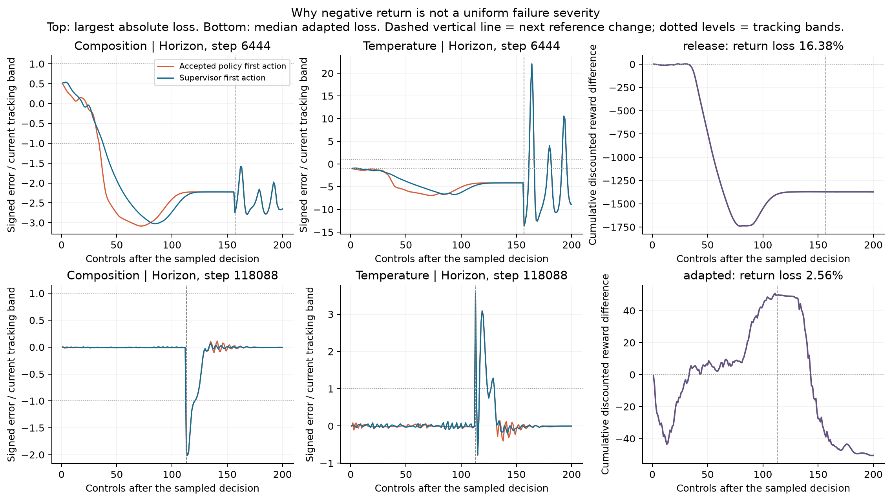
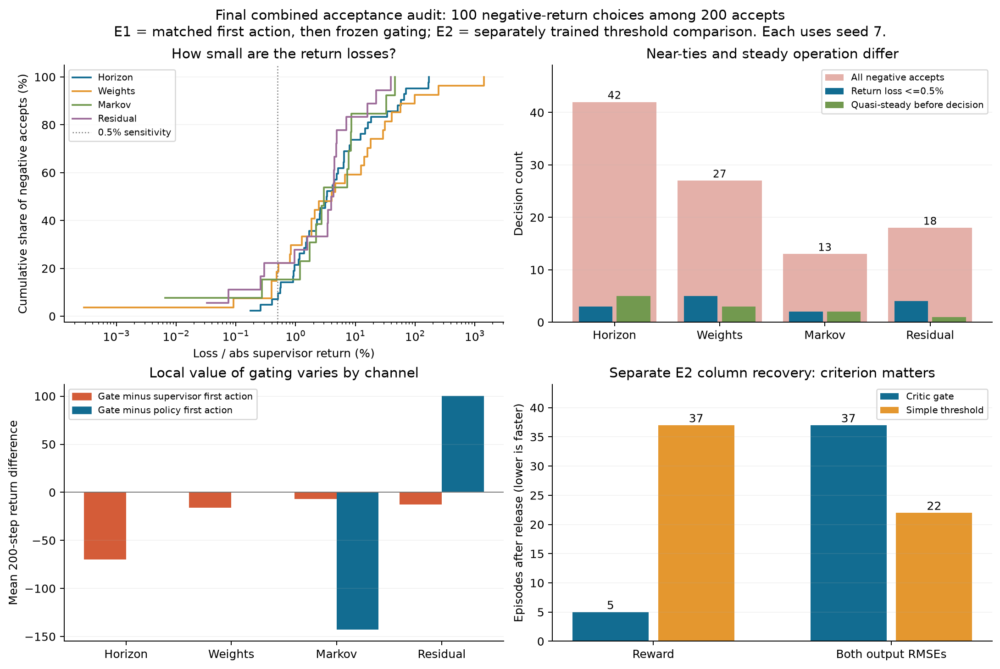

# Follow-up audit of the 100 unfavorable combined acceptances

26 October 2026. This is a separate supplement to the preserved final assessment. It answers the author's question about loss severity, steady-state equivalence, and the apparent disagreement with handoff/recovery performance. It contains no reviewer responses or manuscript changes.

The **100/200 count is correct**. Recalculation of all 320 completed matched comparisons confirms 200 policy acceptances, of which 100 have a negative realized policy-minus-supervisor discounted return over 200 control steps. They are **a mixture of small performance differences and substantive reward/tracking losses**. The data do not support treating most of them as steady-state near-ties. The adapted phase does, however, contain many physically small differences amplified by the reward's near-target bonus.

## What was independently checked

The current accepted combined E1 generation, seed 7, contains 80 decisions per channel and 20 per channel in each of four sampling windows. The complete decision log's canonical SHA256 matches the final assessment. Every NPZ checksum matches its earlier provenance. All 640 primary 200-step branch reward sequences were reconstructed from physical outputs, inputs, references, previous inputs and the unchanged scalar reward definition; maximum step-reward discrepancy was 1.55e-12. All discounted returns and both physical RMSEs match the stored records. All 320 selected-source flags agree with the recorded executed candidate and selected rollout label. Captured pre-decision errors align exactly with the completed main trajectory.

The audit uses the accepted technical recovery generation selected by the campaign protocol. Original pre-recovery alternatives remain archived. These are one seed's sampled decision states, not 320 independent training replications. No new plant integration was executed.

For each pair, only the initial channel decision is forced to its policy or supervisor candidate; both branches then use the same frozen gated controller. Subsequent states and gate decisions can diverge. The supervisor-first-action alternative is not the separately trained simple-threshold controller, nor a complete always-supervisor trajectory.

## How large are the losses?

Relative gap is the absolute return difference divided by the larger of 1 and the absolute supervisor return, using the same existing reward and discount gamma=0.99. The following are **analysis sensitivities, not validated engineering equivalence limits**. The earlier `material_harmful_acceptance` field meant only a return gap below -1 reward unit; that name does not establish practical harm or a safety violation.

| Quantity within the 100 negative acceptances | Count or magnitude |
|---|---:|
| Return loss at most 0.1% | 5 |
| Return loss at most 0.5% | 14 |
| Return loss at most 1% | 24 |
| Return loss at most 5% | 61 |
| Median relative loss | 3.75% |
| Median absolute discounted loss | 67.16 |
| Absolute-loss interquartile range | 36.38–136.01 |
| Largest absolute discounted loss | 1371.94 |

Returns can contain positive and negative rewards, so their denominator can become small through cancellation. Normalizing by discounted absolute rewards instead changes the at-most-0.5% count from 14 to 16 and the at-most-5% count from 61 to 72. A symmetric return denominator gives the same counts as the primary definition at these cutoffs. The conclusion that most losses are not tiny 0.5% ties survives these sensitivities; large relative percentages near a zero return should not be read as equally large physical damage.

| Channel | Policy accepted | Negative accepted | Negative loss at most 0.5% | Median relative loss among negatives |
|---|---:|---:|---:|---:|
| Horizon | 72 | 42 | 3 | 3.33% |
| Weights | 51 | 27 | 5 | 3.99% |
| Markov | 39 | 13 | 2 | 2.98% |
| Residual | 38 | 18 | 4 | 4.14% |

The count is conditional on accepting a sampled proposal. It is not a failure probability for the plant or the fraction of all deployed control moves that are unfavorable.

These are realized finite-horizon comparisons. They do not estimate expected return from repeated identical starting states or establish statistical distinguishability of every small gap. A negative realized difference should not automatically be called a proven critic-estimation error.

## Does steady operation explain them?

Quasi-steady classification uses only the ten controls preceding the decision: an unchanged reference, maximum output increment at most 5% of its tracking band, and maximum input increment at most 0.5% of its identification range. A separate near-target flag simply asks whether both current errors are inside their performance bands.

- **64/100** negative acceptances start inside both tracking bands.
- Only **11/100** satisfy the pre-decision quasi-steady definition.
- Only **4/100** are both quasi-steady and within the 0.5% return-gap sensitivity.
- Varying history over 5/10/20 controls and halving/doubling rate thresholds yields 1–20 quasi-steady cases, always a minority.
- **96/100** contain a future reference change within their 200-step comparison. Being near the target now does not mean the entire comparison is steady.
- **23/100** have a positive first-20-step return difference before becoming negative by step 200. The evaluation horizon matters.

These observations support distinguishing proximity to the target from settled operation and from equivalent future outcomes. They do not directly demonstrate that ambiguous rewards caused training confusion.

## Physical consequences and reward components

For this sensitivity, a small physical tracking difference means that the absolute difference between branch normalized-error RMSEs is at most 0.01 on **both** outputs. Each error is normalized by its actual time-varying target band. This measures closeness of tracking performance, not closeness of entire trajectories, safe operating limits, or controller feasibility.

| Sampling window | Negative acceptances | Small change in both tracking RMSEs | Main reward-loss observation |
|---|---:|---:|---|
| Release | 20 | 2 | Quadratic tracking accounts for 84.5% of net aggregate deficit |
| Mature before plant change | 24 | 18 | Near-target bonus accounts for 90.8% |
| Plant change | 30 | 4 | Mixed tracking, input movement and bonus effects |
| Adapted | 26 | 22 | Near-target bonus accounts for 93.6% |

Across all 100, 46 have small changes in both normalized tracking RMSEs. In 42, at least one RMSE is worse by more than 1% of a tracking band; in eight, both are worse by that amount. These categories do not form a partition: some remaining differences improve an output or trade outputs against each other. Only 23 have a lower fraction of time inside both bands, and **14 have neither physical output RMSE worse despite lower reward**. Discounted timing, input movement and the nonlinear tracking bonus can change the ordering. RMSE alone does not reproduce the reward objective.

The 20 release losses contribute 58.2% of the aggregate absolute negative-return deficit. Thus late near-equivalence should not be used to dismiss the early tracking losses. The largest absolute loss is a horizon decision at step 6444: -1371.94 discounted reward, or 16.38% relative to the supervisor branch. Its composition RMSE is higher by 0.00025184 mole fraction and temperature RMSE by 0.04735 K; its reward decomposition is dominated by the quadratic tracking penalty. Practical acceptability still requires engineering tolerances beyond the arbitrary sensitivities used here.



The top row is the largest absolute accepted loss. The bottom row is the lower median absolute loss among the 26 adapted negative acceptances, selected by a stated rule rather than a favorable visual outcome. This late case has closely overlapping tracking responses while the cumulative reward difference changes sign. The dashed line marks the next reference change. Exact example selection and all scalar values are in `data/example_selection.json`.

## Why can end-to-end handoff and reward recovery still improve?

The local E1 audit and the E2 threshold comparison test different questions. E1 changes one candidate decision at sampled states of the same learned controller. E2 compares controllers trained with different selection rules; after their choices diverge, their states, replay and learned policies also diverge. E1's supervisor alternative is not E2's threshold alternative. Better end-to-end performance is compatible with imperfect local ranking, but that compatibility is not a causal explanation proven by these data.

There is direct local evidence for a protective effect in the **residual** channel: rejecting 23 negative proposals avoids 9665.05 summed counterfactual return loss, while rejecting 19 positive proposals forgoes 1649.96; the net improvement against taking the policy first action is +100.19 per residual sampled state. That finding does not generalize to every channel. Markov has substantial missed beneficial opportunities, and the gate's mean local return is below the supervisor-first-action alternative in all four channels. Across all 320 sampled states it is also below the policy-first-action alternative. These sums combine overlapping hypothetical rollouts and must not be presented as actual accumulated training loss.

In particular, it would be incorrect to explain the 100 unfavorable acceptances by saying the 100 favorable acceptances simply outweigh them. Their discounted gains sum to 6198.94 versus 14635.54 of accepted losses in this diagnostic. Improved E2 outcomes therefore require an end-to-end interpretation rather than a claim of uniformly accurate critic ranking. Candidate bounds, fallback and different training-state visitation are plausible contributors; their individual causal contributions were not isolated.

The independently verified E2 results remain:

| Measure | Critic gate | Simple threshold |
|---|---:|---:|
| Column handoff mean reward, episodes 14–20 | -28.22 | -96.98 |
| Column handoff composition RMSE | 0.008293 | 0.008852 |
| Column handoff temperature RMSE, K | 0.6260 | 1.0620 |
| Column first sustained reward recovery, episodes after release | 5 | 37 |
| Column first sustained recovery of both output RMSEs | 37 | 22 |
| Polymer first sustained reward recovery | 1 | 25 |
| Polymer first sustained recovery of both output RMSEs | 1 | 25 |

Recovery is the first of three consecutive qualifying episodes relative to matched nominal MPC, as defined in the final assessment. It is not a promise of permanent settling. There is one E2 realization per method and plant. In the shorter column window 14–16, composition RMSE is worse with the critic gate, so the favorable 14–20 aggregate must retain its window label. Tracking bands quantify disruption; they are not certified safety constraints.



## Supported interpretation and remaining uncertainty

| Statement | Evidence class | Assessment |
|---|---|---|
| 100 of 200 accepted sampled choices have lower realized 200-step return | Verified empirical observation | Confirmed from raw traces and action labels |
| Most are steady-state near-ties | Hypothesis | Not supported; four satisfy both primary sensitivities |
| Many adapted-phase losses have little effect on output RMSE and reflect bonus sensitivity | Empirical observation | Supported for this run: 22/26 small tracking differences; bonus explains 93.6% of net deficit |
| The critic is a reliable decision-wise improvement oracle | General claim | Not supported by this audit |
| The tested gated training system has better primary-window handoff and reward recovery than the threshold comparator | Empirical observation | Supported in the single-seed E2 comparisons, with the explicit column RMSE-recovery exception |
| Gate-induced state visitation or training differences explain the full benefit | Plausible mechanism | Consistent with the design, not causally isolated |
| Lower return means physical failure or unsafe operation | General claim | Not established by reward ordering or these performance bands |

The practical handoff argument can proceed with these limitations visible. The evidence supports the tested system's transient and reward-recovery benefits; it does not support claiming uniform channel-wise dominance, calibrated decision values, or mathematical safety. No reviewer responses have been drafted.

## Reproduction and preservation

Run from the scientific repository with its existing private numerical reader:

```powershell
& 'C:\Users\hamediaa\AppData\Local\PythonEnvs\rl-assisted-env\python.exe' -B 'change-reports\combined_acceptance_audit_20261026\audit.py'
```

This rereads completed data and recreates only this supplement's derived tables/figures. It launches no Aspen application or training worker. The script asserts the earlier final package remains unchanged. The 146 files present in that package were byte-identical before and after this analysis. The manuscript, all scientific outputs, full recovery state and archives were not modified.

Files inspected: repository `AGENTS.md`; the four research skills listed in `data/verification.json`; the final assessment's `analyze.py`, `final_comparison.py`, gate/provenance/reward-parameter/recovery/handoff records; final combined `training.pkl`; all 320 accepted decision traces and their complete decision log; `review_numeric_recovery.py`; and `utils/rewards.py`. Exact source paths, SHA256s and validation receipts are in `data/verification.json`; each row in `data/all_320_decisions.csv` also identifies its trace checksum. Existing final package files were hashed as a preservation guard.

Files created: `audit.py`, this `AUDIT.md`, the contract, per-decision/negative-only and grouped CSVs, threshold sensitivities, reward decomposition, example-selection and verification JSON, and two PNG/SVG figure pairs, all under this new supplement directory. Unrelated `run_polymer_phase2_repeats.py` edits were left untouched. No frozen assessment file was overwritten.
