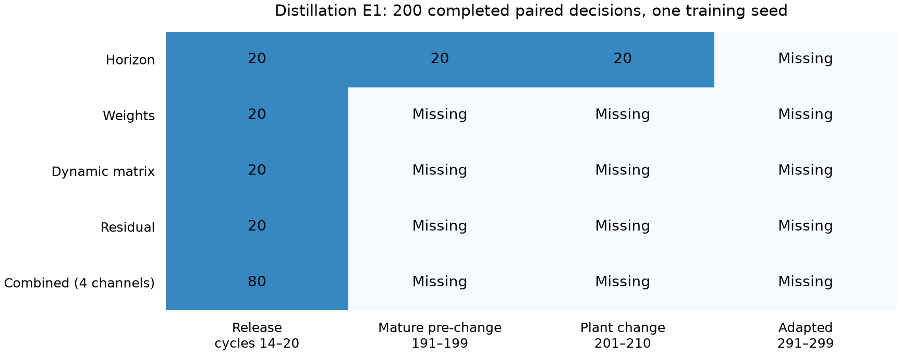

# Partial column E1: reviewer-use assessment

The current 200 paired decisions are usable as explicitly partial, exploratory diagnostics for R2.1, which asks whether critic advantages reflect actual action consequences, particularly at release. All five configurations cover release; horizon additionally covers mature pre-change and plant change. These data can accompany the previously completed polymer E1 and E2/comparator evidence. They do not constitute the planned 640-pair column study or close every reviewer concern. A narrower E1 response is a defensible budget choice if Amir accepts the missing phases and the negative findings. Reviewer acceptance cannot be predicted.

## Evidence that can be retained now

The independent audit verifies 200 unique canonical decisions, original prospective sampling membership and protocol hash, completed policy/supervisor branches, unchanged live native state and learner counters, original native restoration checks, ZIP integrity, finite core traces and trace shapes. Discounted returns were recomputed from every raw reward trace and match the saved metrics. No original result or active checkpoint was modified. Optional Markov prediction-error logs contain unset NaNs; core output/input/reference/reward traces are finite. Markov solver-failure counts are missing, not established as zero.

## What these results say

For each sampled state, compare the actual exploratory policy proposal with the supervisor proposal and then use the same frozen gated continuation. The primary difference is policy return minus supervisor return over 200 steps, with the original per-step discount. Actual-gate regret is the larger of zero and the better branch's return minus the initially selected branch's return. Always-supervisor/policy alternatives change only the first choice; they are not separately trained controllers. Raw critic ranking uses the DQN Q difference or minimum twin-Q difference and does not represent the complete penalized TD3 selection score.

| Configuration | Channel | Window | Pairs | Accepted with lower return / accepted | Raw rank correct / cases | Mean gate regret | Mean supervisor-initial regret | Mean policy-initial regret |
| --- | --- | --- | ---: | ---: | ---: | ---: | ---: | ---: |
| combined | horizon | release | 20 | 11/13 | 2/14 | 261.653 | 9.369 | 260.315 |
| combined | markov | release | 20 | 1/3 | 9/20 | 811.177 | 761.770 | 287.592 |
| combined | residual | release | 20 | 2/2 | 11/20 | 102.768 | 34.039 | 515.919 |
| combined | weights | release | 20 | 6/13 | 11/20 | 41.821 | 21.865 | 36.675 |
| horizon | horizon | plant_change | 20 | 10/20 | 10/20 | 31.094 | 5.748 | 31.094 |
| horizon | horizon | prechange_mature | 20 | 6/16 | 10/16 | 5.669 | 19.077 | 5.669 |
| horizon | horizon | release | 20 | 5/9 | 5/11 | 53.298 | 33.235 | 53.118 |
| markov | markov | release | 20 | 0/3 | 13/20 | 51.683 | 80.462 | 147.951 |
| residual | residual | release | 20 | 1/2 | 14/20 | 30.641 | 21.569 | 823.829 |
| weights | weights | release | 20 | 2/9 | 12/20 | 29.292 | 36.081 | 0.174 |

All sign counts use the original zero return tolerance, so small differences count. The CSV also reports accepted differences below minus one reward unit as a labeled sensitivity check. Results are mixed and include unfavorable gate decisions. They support treating the critic gate as an empirical action selector with observed failure modes; they do not establish calibrated confidence, uniformly better action ranking, a safety safeguard or a stability guarantee.

## Current budget decision and interim interpretation

Retain all 200 observed pairs and every unfavorable result. Do not pool the extra horizon windows with the other configurations as a fair cross-configuration comparison; compare their common release window separately. Explicitly report 440 missing planned pairs, missing adapted-window evidence, the three technical failures and a subsequent resource-driven stopping decision if approved. Decisions share one training seed and are correlated; do not add seed-level confidence intervals or treat the row counts as independent training replications. This is a post hoc partial evidence package, with no claim of an outcome-independent complete campaign.

Amir explicitly chose to recover E1 and continue toward the approved 640 pairs after reviewing the partial-evidence option. Accordingly, neither active E1 worker is stopped, the three failed configurations are being recovered through separate owned native processes, and the ten combined repetitions and their coordinator remain protected. This 200-pair package is an immutable interim analysis, not an early termination or a declaration that the planned study is complete.

## Draft response direction

We agree that learned critic differences are not calibrated confidence measures. We therefore report matched action-choice diagnostics at release for all tested column configurations, together with additional pre-change and change-response observations available for horizon selection. Each pair starts from the same saved plant/controller state and uses a common frozen continuation. The observed choices include lower-return policy acceptances and rejected beneficial proposals, which we report rather than interpreting the gate as a guarantee. This partial column diagnostic has one training seed and incomplete training-phase coverage because of native simulation failures and computational limits. It complements the separate polymer diagnostics and controller comparisons; it does not establish universal selector reliability.

This is working response material. It has not been inserted into the manuscript or response letter, and no reviewer comment is marked resolved by this report.

## Preservation and compression

The compact reviewer package retains the canonical decision records, all 200 paired raw NPZ traces, numerical summary, sampling definitions, job/configuration descriptors, source hashes, native-restoration receipts and this audit. Native simulator exports and replay/optimizer checkpoints remain in their existing recovery archives; they are not necessary inside the reviewer-sharing package. Excluding them from that package does not delete them. Preserve recent full checkpoints and frozen policies for restart/reproduction. Use lossless, hash-verified compression for inactive historical checkpoints; avoid changing active checkpoint filenames or simulator files.

Sources: canonical folders and trace SHA-256s are enumerated in analysis_manifest.json and ../partial_results_audit.json. Generator: ../build_partial_analysis.py. Units: discounted original reward units; one column seed (7), SG mode; channels are reported separately. No original manuscript, TeX, PDF, existing scientific runner or training protocol was changed. Separate recovery adapters were added without modifying any live worker.
