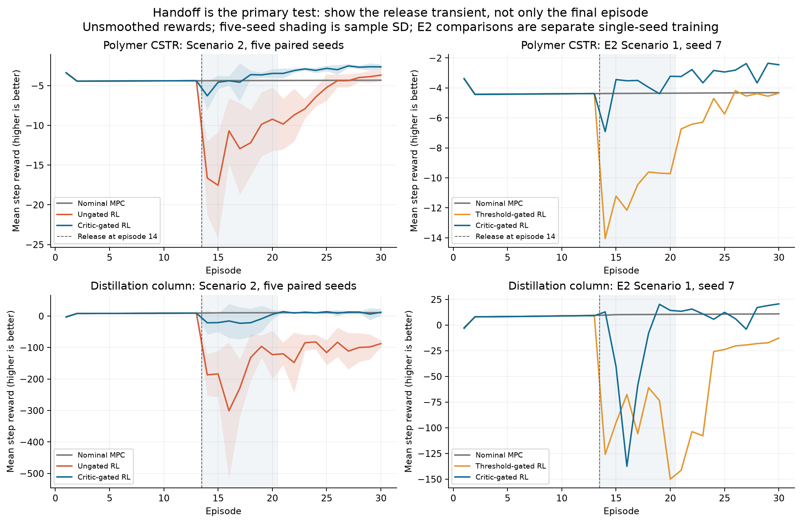
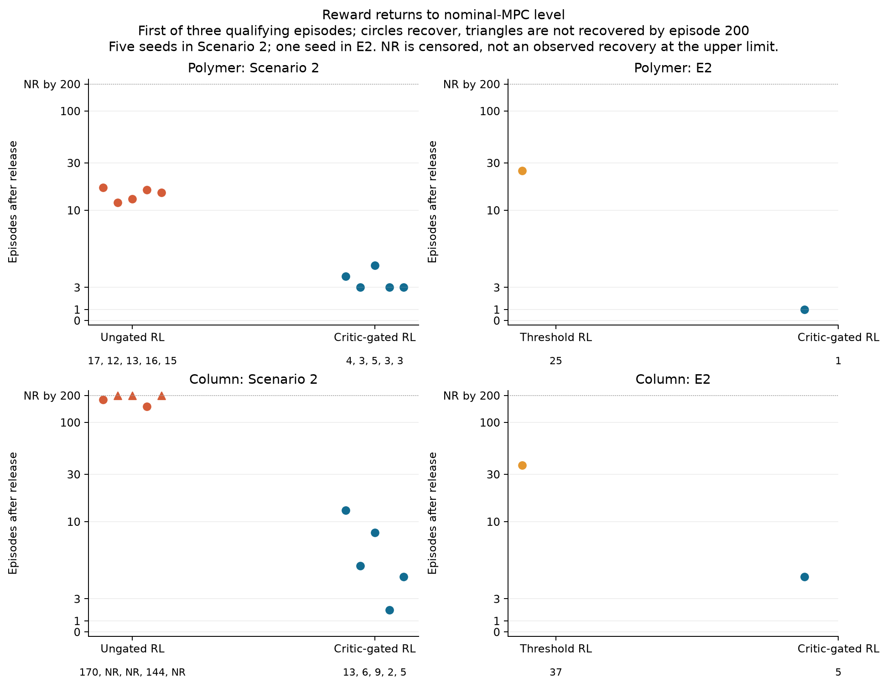
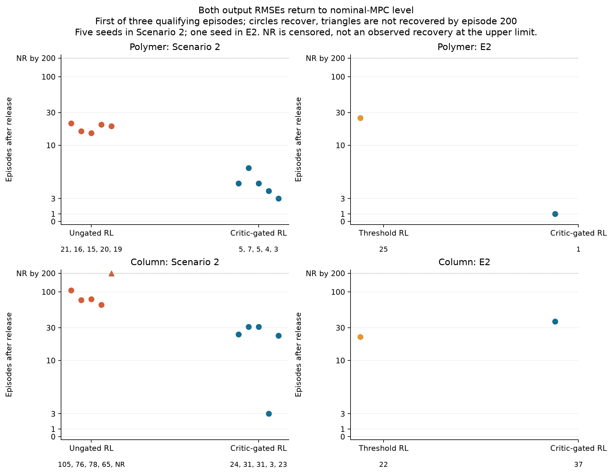
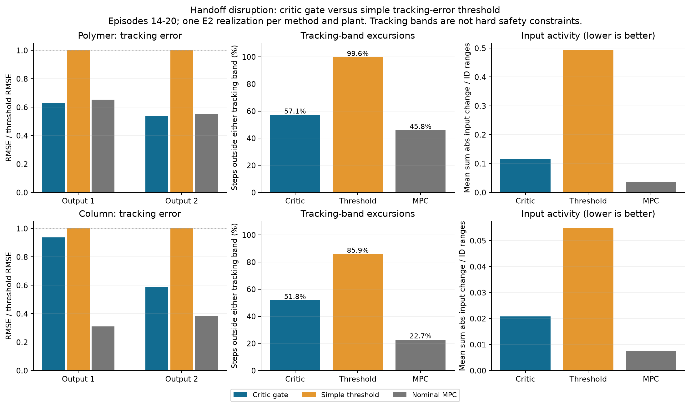
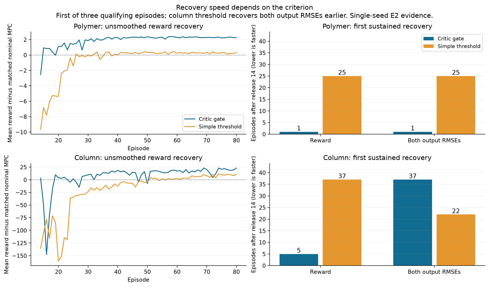
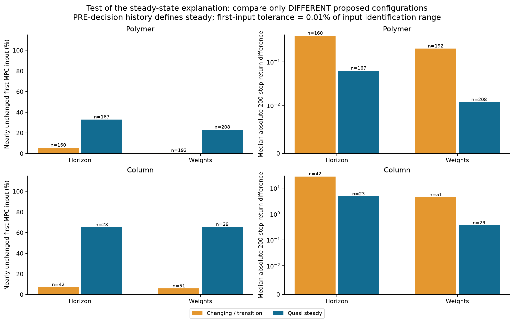
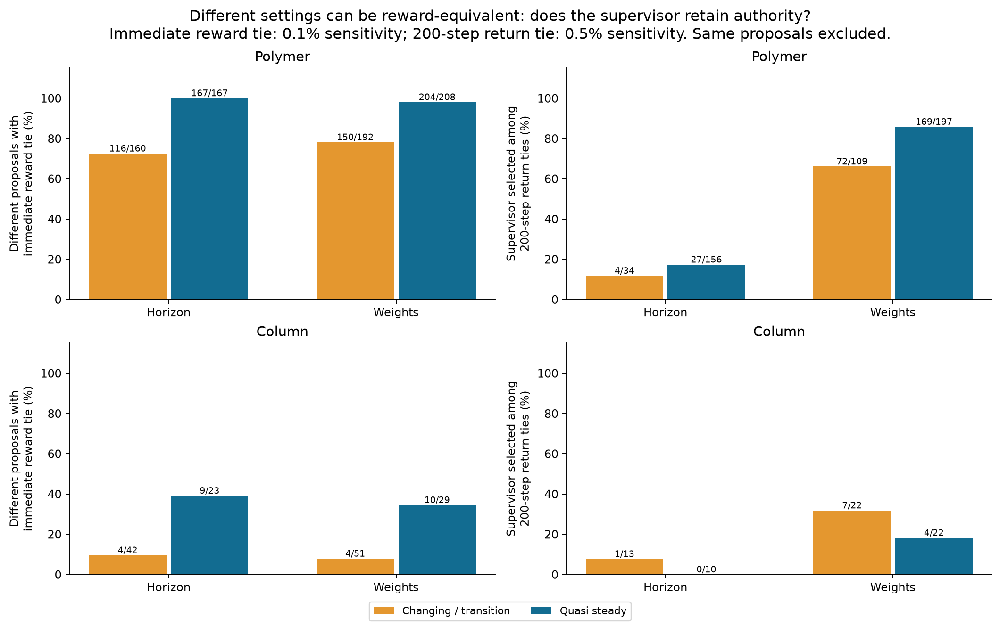
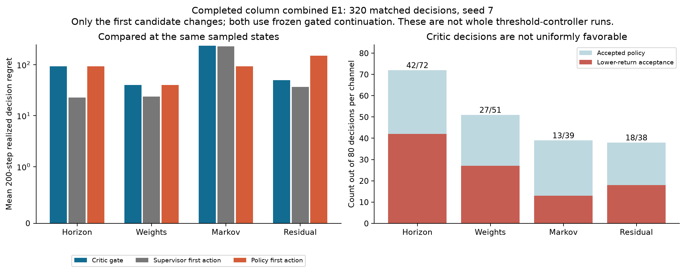
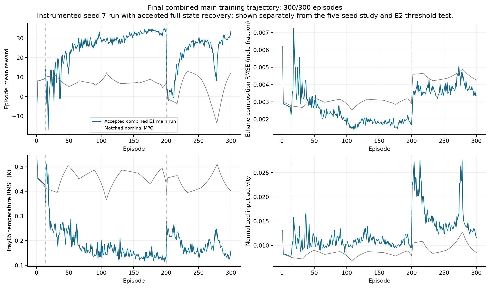
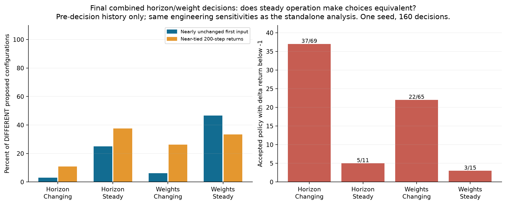

# Final practical handoff, recovery and critic-decision assessment

October 26, 2026. All scheduled campaign runs are complete. This new version includes all 640/640 column E1 pairs, combined 320/320, the complete accepted 300-cycle combined training trajectory, and the original 3200 polymer pairs. It preserves the October 24 assessment rather than overwriting it.

**The strongest supported argument is reduced disruption and faster recovery when introducing learned assistance, particularly for residual and combined control.** The results do not show uniform superiority across every channel, operating phase, comparator or metric. No manuscript or reviewer response has been edited.

**Important qualification from the complete E1 audit:** 100 of 200 column-combined policy acceptances have lower 200-step return than their matched supervisor alternative. The observed handoff benefit does not establish reliable critic action ranking; the negative results are reported below.

## Evidence and validation

The analysis includes all 100 completed Scenario 2 training runs: two plants, five assistance families, SG/plain, five prescribed seeds (7, 11, 23, 37, 53), and 300 episodes per run. There are two matched saved nominal-MPC references, 12 E2 controller/reference trajectories including the supplemental recovered polymer threshold, 3,200 completed polymer E1 pairs and all 640 completed column pairs. E3 is independently recomputed from saved forecast probes and reproduces all 576 existing summary rows.

All primary trajectory arrays are finite and aligned after the control action. All stored RL rewards agree with the same fixed plant-specific reward; the vectorized calculation is also checked against the unchanged scalar reward implementation. References match. Raw files have SHA-256 provenance. All 3,840 E1 paired returns and output RMSEs are recomputed from raw NPZ signals. The state analysis joins 960 standalone horizon/weight decisions to their original training histories; every captured initial tracking error matches exactly.

Some original exports omit reward-parameter metadata. An explicit saved parameter record is accepted only after the entire original reward array agrees with that score. Native numerical runtimes differ across recoveries; identical seeds do not imply bitwise identical training. Optional unset diagnostics and missing solver-failure counters are not converted to zeros.

No simulator is opened or reset. Original scientific sources, trajectories, results, checkpoints, archives and the unrelated dirty polymer runner remain untouched. Derived analysis runs use the existing private numerical runtime, one numerical thread and low process priority.

## Handoff: combined controller, episodes 14-20

These are means of the five seed-level results. Reward is higher-is-better. Output RMSE and input activity are lower-is-better. Input activity is mean absolute input movement normalized by each input's identification range.

| Plant | Mode | Reward | Output 1 RMSE | Output 2 RMSE | Input activity |
| --- | --- | ---: | ---: | ---: | ---: |
| Polymer | Nominal MPC | -4.361 | 0.19031 | 0.55628 | 0.03558 |
| Polymer | Ungated RL | -12.726 | 0.30869 | 1.13013 | 0.55146 |
| Polymer | Critic SG | -4.358 | 0.18645 | 0.59529 | 0.13941 |
| Column | Nominal MPC | 10.149 | 0.002755 | 0.41007 | 0.00746 |
| Column | Ungated RL | -178.806 | 0.009585 | 1.48059 | 0.06019 |
| Column | Critic SG | -15.150 | 0.006316 | 0.56468 | 0.01582 |

Relative to ungated combined RL, SG reduces the two handoff output RMSEs by about **39.6% and 47.3% for polymer**, and **34.1% and 61.9% for the column**. Normalized input activity falls about **74.7% and 73.7%**. Percentages are ratios of the displayed seed means, not significance probabilities.

Both plants have 5/5 positive paired combined handoff reward gains. Standalone residual also wins 5/5 in both plants. The gains are much smaller and less consistent for horizon and weights.

| Plant | Family | Positive paired handoff reward gains | Mean SG minus plain reward |
| --- | --- | ---: | ---: |
| Polymer | Horizon | 2/5 | -0.00448 |
| Polymer | Weights | 2/5 | -0.10110 |
| Polymer | Matrix | 4/5 | 0.18560 |
| Polymer | Residual | 5/5 | 8.50136 |
| Polymer | Combined | 5/5 | 8.36754 |
| Column | Horizon | 1/5 | -0.43915 |
| Column | Weights | 3/5 | 0.33744 |
| Column | Matrix | 5/5 | 59.53856 |
| Column | Residual | 5/5 | 120.34568 |
| Column | Combined | 5/5 | 163.65577 |

Retaining nominal MPC still performs better during column release; SG does not eliminate every release dip. The practical benefit is reducing the damage of introducing RL while retaining subsequent adaptation. It does not mean every baseline metric is preserved.

## Recovery speed

Two complementary criteria are reported: episode mean reward at least the matched nominal-MPC episode, and both output RMSEs no worse than the matched nominal-MPC episode. Recovery requires three consecutive qualifying episodes. The reported time is the first qualifying episode minus release episode 14; two later episodes confirm it. This measures benchmark-relative performance recovery, not a physical settling-time constant.

The search ends at episode 200 before the next operating change. Non-recovery is censored and is never dropped or replaced by an invented recovery time. All seeds contribute to the median; a censored median is reported as not reached. One- and five-episode sensitivities, operating-change recovery and the accumulated positive reward deficit over the entire fixed window are retained in the data. Later relapses remain visible in the unsmoothed curves and deficit measure.

| Study | Plant | Recovery criterion | Critic SG | Comparator |
| --- | --- | --- | ---: | ---: |
| Five-seed Scenario 2 | Polymer | Reward | median 3 episodes | ungated median 15 |
| Five-seed Scenario 2 | Polymer | Both output RMSEs | median 5 | ungated median 19 |
| Five-seed Scenario 2 | Column | Reward | median 6; 5/5 recover | ungated median not reached; 2/5 recover by 200 |
| Five-seed Scenario 2 | Column | Both output RMSEs | median 24; 5/5 recover | ungated median 78; 4/5 recover |
| Single-seed E2 | Polymer | Reward | 1 | threshold 25 |
| Single-seed E2 | Polymer | Both output RMSEs | 1 | threshold 25 |
| Single-seed E2 | Column | Reward | 5 | threshold 37 |
| Single-seed E2 | Column | Both output RMSEs | 37 | threshold 22 |

The replicated comparison strongly favors SG recovery against ungated RL. The threshold comparison is more nuanced: SG recovers reward faster in both plants, but the single column threshold realization reaches the both-output MPC-RMSE criterion earlier. That counterexample is retained. A claim of faster recovery must name its metric.

## Is the simple threshold better?

The raw recheck confirms that SG is better over the handoff window in both plants and over the full post-release window. Threshold uses the same four-channel learner structure with a tracking-error threshold acceptance rule; it is not an MPC-only controller.

| Plant | Window | Critic SG reward | Threshold reward |
| --- | --- | ---: | ---: |
| Polymer | Release 14-20 | -4.134 | -10.983 |
| Polymer | Postrelease 14-200 | -1.973 | -4.096 |
| Polymer | Evaluation 200 | -1.680 | -3.466 |
| Column | Release 14-20 | -28.217 | -96.982 |
| Column | Postrelease 14-200 | 25.017 | 11.754 |
| Column | Evaluation 200 | 35.394 | 36.248 |

Column pre-release SG/threshold histories match exactly. Polymer has small pre-release differences: maximum output difference 0.0005544 and input difference 0.06008 in saved physical units, with identical references. These are separately trained end-to-end comparisons; later replay and policies can differ after their acceptance decisions diverge. E2 has one realization per method, not a five-seed threshold replication.

The initial concern came from the column final episode alone. SG has lower final RMSE for both outputs, but threshold has slightly higher reward. Independent reward decomposition explains this: threshold's near-target bonus is 39.5881 versus SG's 38.4068, outweighing larger aggregate penalties. The reward is nonlinear, so the ordering of its mean need not match output RMSE ordering. No label swap, scoring mismatch or smoothing error was found.

The recovered polymer threshold is also included as supplementary same-seed data and remains worse than SG at handoff. It is not counted as an independent additional seed.

## Direct threshold comparison: handoff and recovery

E2 is an end-to-end training comparison at seed 7. The threshold accepts an eligible learned proposal when the maximum output tracking error divided by its tracking band is no larger than its warm-up-calibrated cutoff. Its cutoff is max(1,1.25 times the 95th percentile warm-up normalized error). Critic scores remain shadow diagnostics in that arm and do not determine acceptance. Learners, bounds, readiness, release and replay machinery are retained. Later policies/replay can diverge after the choices differ; this is not a selector-only fixed-policy experiment.

| Plant | Handoff output 1 RMSE reduction | Output 2 RMSE reduction | Input activity reduction | Fewer band excursions (percentage points) |
| --- | --- | --- | --- | --- |
| Polymer | 37.0% | 46.3% | 76.6% | 42.5 |
| Column | 6.3% | 41.1% | 61.9% | 34.1 |

Primary handoff window: episodes 14-20. Lower input activity and fewer excursions support reduced empirical handoff disruption; tracking bands are performance targets, not certified safe operating limits. Nominal MPC is still better on several handoff metrics, and SG uses more input activity than nominal. No formal safety, feasibility, operating-envelope or deployment guarantee follows.

| Plant | Recovery criterion | Critic gate | Simple threshold |
| --- | --- | --- | --- |
| Polymer | reward | 1 | 25 |
| Polymer | both output rmse | 1 | 25 |
| Column | reward | 5 | 37 |
| Column | both output rmse | 37 | 22 |

Recovery numbers are episodes after release 14, using the first of three consecutive benchmark-qualifying episodes. They measure training-performance recovery against matched nominal MPC, not physical settling times. Critic gating recovers reward earlier in both plants; the column threshold recovers both output RMSEs earlier (22 versus 37). The accumulated positive reward deficit over episodes 14-200 is 2.57 versus 56.07 for polymer and 321.60 versus 1564.02 for the column (critic versus threshold; sums of episode-mean deficits). The raw curves and one-/five-episode sensitivities remain available.

Window sensitivity also matters: over the shorter column episodes 14-16 window, critic composition RMSE is 64.6% higher than threshold, while temperature RMSE, reward and input activity are better. Over the specified 14-20 and the 14-25 windows both output RMSEs favor the critic. These are disclosed analysis sensitivities, not a reason to change the primary window. Threshold also has higher column episode 200 reward despite worse RMSE, as independently explained by the near-target bonus. A universal handoff or recovery superiority claim is therefore unsupported.

## Horizon and weights: steady-state and value-equivalence hypothesis

The state classification uses only the ten steps BEFORE the decision: constant reference, output increments no more than 5% of a current tracking band per step, and input increments no more than 0.5% of the input identification range per step. Being near the target is recorded separately from being dynamically quiet. Stricter and looser thresholds are retained.

The input comparisons below condition on DIFFERENT proposed configurations, excluding the trivial case where policy and supervisor propose the same action. Nearly unchanged means at most 0.01% of the input identification range.

| Plant | Channel | Nearly unchanged first input, quasi steady | Changing/transition | Median abs return difference, steady | Changing/transition |
| --- | --- | ---: | ---: | ---: | ---: |
| Polymer | Horizon | 55/167 | 9/160 | 0.06250 | 0.39874 |
| Polymer | Weights | 48/208 | 1/192 | 0.01178 | 0.20226 |
| Column | Horizon | 15/23 | 3/42 | 4.76066 | 28.18497 |
| Column | Weights | 19/29 | 3/51 | 0.36200 | 4.43259 |

The data support smaller consequences and more first-input equivalence near steady operation. In the column, about 65% of differing horizon/weight proposals leave the first input nearly unchanged in quasi-steady conditions, versus about 6-7% during changing conditions.

The reward-equivalence and supervisor-retention parts of the hypothesis must be distinguished. The next table uses a 200-step near-tie sensitivity of 0.5% of max(1, absolute supervisor return), not an assertion of exactly identical values.

| Plant | Channel | Near-tied returns among differing quasi-steady proposals | Supervisor selected in those ties |
| --- | --- | ---: | ---: |
| Polymer | Horizon | 156/167 | 27/156 |
| Polymer | Weights | 197/208 | 169/197 |
| Column | Horizon | 10/23 | 0/10 |
| Column | Weights | 22/29 | 4/22 |

Value ambiguity is supported, particularly in polymer. Supervisor retention in ambiguous cases is strong for polymer weights but not universal; column horizons use the RL proposal in all ten of their quasi-steady near-ties. The gate compares estimated advantages and margins; it does not directly detect steady state or observe the future realized return.

Restricting the same diagnostic to quasi-steady decisions already inside both tracking bands gives polymer horizon 81/88 near-tied returns and weights 158/164; the supervisor is retained in 19/81 and 132/158 of those ties. Both column subsets are unchanged. The conclusion therefore also holds near the target, rather than depending only on slow operation away from it.

Equivalent outcomes can make fine value ranking difficult and can motivate retaining a default action when estimated advantage is insufficient. **The data do not directly establish that this ambiguity destabilized training, or that the supervisory layer consistently takes over in every steady-state case.** Those remain interpretations to test, rather than conclusions upgraded from equal rewards.

Some negative sign counts are practically small. They do not explain all unfavorable acceptances. A state that is steady now can also face a reference switch inside the 200-step rollout; short-term input equivalence and long-term return equivalence are therefore shown separately. The analysis does not claim that the optimization objective, Hessian, optimizer or complete future input sequence is mathematically identical.

## What the complete combined decision audit actually shows

All 320 column combined decisions are available:80 per channel and 20 per channel/window cell. Among 200 policy acceptances,100 have lower 200-step realized return than the matched supervisor alternative;96 are below minus 1 reward unit under the retained magnitude sensitivity. There are 57 beneficial rejections. Counts describe prospectively sampled, dependent states from one training seed, not population failure probabilities or independent experiments.

| Channel | Lower-return accepts / accepts | Mean selected gain vs supervisor | Median selected gain | Critic regret | Supervisor-first-action regret |
| --- | --- | --- | --- | --- | --- |
| Horizon | 42/72 | -69.73 | -8.33 | 92.51 | 22.78 |
| Weights | 27/51 | -16.19 | 0.00 | 39.89 | 23.70 |
| Markov | 13/39 | -6.88 | 0.00 | 235.41 | 228.53 |
| Residual | 18/38 | -12.65 | 0.00 | 49.44 | 36.79 |

The mean selected first-action gain is negative for each channel when the four sampled phases are equally weighted. This is unfavorable evidence for consistent critic ranking at those states. At the adapted window, Markov, weights and residual have positive mean selected gains (20.17,7.52 and 11.71), while horizon remains negative (-22.56). Both favorable and unfavorable cells are retained. Means can be influenced by large losses; medians and per-state returns are provided. Of 32 extended 800-step comparisons, one changes the sign of the primary 200-step return difference.

Only the candidate first action changes and the later controller is the same frozen gated continuation. The supervisor-first-action comparator is therefore neither a trained threshold controller nor an always-MPC trajectory. These diagnostics do not contradict a favorable end-to-end handoff comparison, but they prevent using that comparison as proof that the critic reliably identifies the better action. Neither finite-horizon returns nor twin-critic penalties establish calibrated uncertainty or a stability theorem.

The accepted full main trajectory is shown separately; it is not an extra replicate in the 100-run study. All four learners, full recovery state and original technical replay alternatives are retained. Native integration after the accepted cold restore is not claimed bitwise identical to the original failed suffix. The final accepted generation is selected by the pre-existing recovery protocol, not by favorable performance.

### Steady state in the final combined run

The same pre-decision classification and numerical sensitivities were applied to 160 final combined horizon/weight states; captured errors match the saved main history. Different configurations more often produce nearly unchanged first inputs at quasi-steady states: horizon 2/8 versus 2/65 changing states; weights 7/15 versus 4/65. Near-tied 200-step returns occur in 3/8 quasi-steady horizon proposals and 5/15 quasi-steady weight proposals. The supervisor is retained in 0/3 and 4/5 of those ties, respectively. Thus value ambiguity and conservative retention are supported in some subsets, especially weights, rather than as a universal rule.

Five quasi-steady horizon states and three quasi-steady weight states still have accepted losses below minus 1; all eight begin inside both tracking bands. Steady operation therefore does not explain away every unfavorable decision. A quiet present does not imply an unchanged future reference or an identical MPC solution. The data still do not directly establish that reward-equivalent choices caused training confusion or that the gate detects steady state explicitly.

## Other findings and limits

- E1 includes genuinely lower-return acceptances and beneficial rejections, including material losses. Its alternatives change the FIRST action and then use the same frozen gated continuation; they are not independently trained always-policy or always-supervisor controllers. One training seed and dependent, prospectively selected states do not support seed-level confidence intervals or plant-wide failure-frequency estimates.
- E3 executed predictors improve lead-eight RMSE in 14/24 groups per plant, worsen it in 8/24 and tie in 2/24. Polymer ratios to nominal are approximately 0.984-1.009; column ratios span 0.434-1.295. Known future inputs are supplied. Better control does not imply uniformly better prediction.
- Nominal checkpoint forecasts exist only in mature/adapted windows. Missing release/change cells are explicitly shown as not sampled.
- Column combined SG improves both final output RMSEs over ungated RL in every paired seed. Polymer ungated combined RL has slightly better mean final reward/output RMSEs than SG, while SG uses less input movement. The strong polymer argument is handoff mitigation and recovery, not uniform final-performance dominance.
- The saved handoff effects are smaller and less consistent for horizon/weights. The standalone paired-decision consequences are also generally smaller for those channels than for residual/dynamic matrix. These conditional diagnostics do not identify causal individual-agent contributions without ablations.
- SG can use more input movement than nominal MPC. Input activity and physical-output trade-offs remain visible in every relevant comparison.

## Reviewer readiness

All scheduled runs in this campaign have completed; the hourly monitor is disabled after verified final preservation. We can begin evidence-based revision work, but cannot mark all reviewer requests resolved. The 24-comment readiness table is in [REVIEWER_READINESS.md](REVIEWER_READINESS.md). Remaining distinct dependencies include frozen-policy unseen references, E4 joint-action consequences, E5 stress/supervisory sensitivity, literature checks and R1.4's analytical request. The author's practical emphasis and theory-as-future-work decision is preserved; it is not presented as a mathematical result. No response has been drafted or manuscript edited.

## Files and reproduction

This folder contains the independent analysis scripts, all per-seed/window/decision tables, metric definitions, SHA-256 provenance and the complete figure set. The offline gallery and PDF booklet show every figure; SVG counterparts support vector export. Raw research results and native recovery data remain in their original verified locations and retained lossless archives.

Files inspected are enumerated by the provenance tables and include original reward/alignment/E1/E3 source, current accepted recovery audits, and the paper roadmap/backlog/response placeholders. Files changed are confined to this new assessment folder and concise operational notes. Original scientific runs, results, sources, queue plans and unrelated dirty user files remain intact.

Reproduction order: analyze.py controls; analyze.py gates; verify_comparators.py; plot_results.py; reward_check.py; recovery_analysis.py; steady_state_analysis.py; final_comparison.py; build_assessment.py; verify_analysis.py; final_checks.py; package_figures.py. Use the documented base interpreter with -B. E3 verification writes fresh derived destinations; use verify_comparators.py --e 2-only to refresh E2 without repeating the closed E3 derivation.

The new package has 24 PNG/SVG figure pairs, all 3840 raw E1 comparisons and complete source/metric provenance. Inspected files are enumerated in the provenance tables, final completion receipts and read-only paper snapshot. Changed files are confined to this new versioned assessment. The 85 prior assessment files, scientific sources/results/recovery data, manuscript/response files and unrelated dirty polymer runner are preserved.
